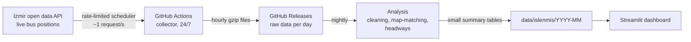

# İzmir Bus Regularity

**English** · [Türkçe](README.tr.md)

**How regularly do İzmir's buses actually arrive?** This project collects the live position of every ESHOT bus from İzmir Metropolitan Municipality's open data API, around the clock, and measures how long passengers really wait at each stop, how often buses bunch together, and which lines, stops and hours are the least reliable.

**Live dashboard (Turkish):** https://eshot-dashboard-vl3mbvk4e7zbeq8dyqga2c.streamlit.app

- **All 446 ESHOT lines**, every active line sampled about every 5 minutes, 24/7
- **Fully automated and free to run:** collection, storage, nightly analysis and the dashboard all run on GitHub Actions and Streamlit Community Cloud
- **Monthly results** with "highlights of the month": the most punctual line, the line with the most long waits, and the line where buses bunch the most

## How it works



1. **Collect.** `collector.py` asks the API for the positions of every bus on each line. Lines with buses on the road are polled every 5 minutes, empty lines every 30 minutes.
2. **Store.** Raw data is uploaded hourly to a daily GitHub Release instead of the git history, so the repository stays small.
3. **Clean.** Ghost records are removed (see below).
4. **Map-match.** Each position is projected onto the official route geometry and converted into "metres from the start of the route".
5. **Detect stop passages.** The moment a bus passes a stop is interpolated between two consecutive positions.
6. **Measure headways.** The time between two consecutive buses at the same stop is the waiting time a passenger experiences in the worst case.
7. **Summarise.** Each calendar month is summarised per line, direction, stop and hour into small CSV files that the dashboard reads.

## What I found in the data (and how I dealt with it)

**About half of the API's records are "ghosts".** For each bus, the API returns the live position together with stale positions that never change. My first hypothesis, that the first record is the live one, turned out to be wrong: the order is random. Testing it against the data showed that **96% of (bus, moment) groups contain exactly one moving record**, and the rest are frozen. So the cleaning rule keeps the record that moves and drops coordinates that repeat across many polls. When I checked the places where ghost records pile up on a map, they turned out to be bus garages, a transfer hub and a petrol station: the last place each bus stopped while out of service.

**The API allows ~60 requests per minute.** My first all-lines collector sent 446 requests in parallel, and about 85% of them were rejected with `API rate limit exceeded`. The collector now uses an adaptive scheduler. It slows down by 15% when it hits the limit and speeds up gently while requests succeed, which keeps it just under the limit (about 1.5% of requests are rejected and automatically retried). It also prioritises lines that currently have buses.

**5-minute sampling is accurate enough.** I collected 1-minute data for 5 lines, thinned it to one sample every 5 minutes and re-ran the analysis. For 9 of the 10 line-directions, the typical wait changed by less than a minute and the long-wait share by only a few percentage points.

**Timetables change during the day.** Buses are planned to run less often in the evening and at night. Comparing every wait with the line's all-day typical wait therefore labelled planned evening gaps as "long waits". Each wait is now compared with the typical wait of the same line **in the same time band** (night, morning peak, daytime, evening peak, evening). For one of the hospital lines, this lowered the long-wait share from 29% to 20%.

**Single-bus lines need to be measured too.** At first I measured headways between two consecutive *different buses*. That skipped every line run by a single bus and, more importantly, hid the long gaps that appear when one of a line's few buses goes out of service. Measuring between two consecutive *different trips* instead raised the number of measured lines from 291 to 384 and revealed hidden long waits on several low-frequency lines.

**Route ends are unreliable.** Buses wait and turn around at the terminus, so passages there are often missed and create fake long gaps. Stops with clearly fewer detected passages than the rest of the route are excluded automatically.

## Metrics

| Metric | Definition |
| --- | --- |
| Typical wait | Median time between two consecutive trips at a stop |
| Long wait | Share of gaps longer than 1.5× the typical wait in the same time band |
| Bunching | Share of gaps shorter than 0.5× the typical wait in the same time band (two buses arrive almost together) |

Rankings and highlights only include line-directions with at least 200 measurements and a typical wait of at least 3 minutes.

## Repository

| File | Purpose |
| --- | --- |
| `collector.py` | Live position collector with the rate-limited scheduler |
| `temizlik.py` | Ghost-record cleaning |
| `analiz.py` | Map-matching, stop passages, headways and monthly summaries |
| `app.py` | Streamlit dashboard |
| `referans_indir.py` | Downloads stops, lines and route geometry from the open data portal |
| `.github/workflows/` | Collection (continuous), analysis (nightly), reference data (monthly) |
| `data/ref/` | Reference data (stops, lines, routes) |
| `data/islenmis/` | Monthly summary tables read by the dashboard |

Raw position data is in the repository's [Releases](../../releases) (one release per day).

## Run locally

```bash
pip install -r requirements.txt
python referans_indir.py                     # stops, lines, routes
python collector.py --tek-sefer              # one test poll for 5 sample lines
python analiz.py --hepsi                     # analyse all available months
streamlit run app.py
```

## Limitations

- Planned timetables are not available as open data, so regularity is measured against each line's own typical wait, not against the schedule.
- Weekday and weekend timetables are not separated yet.
- With ~60 requests per minute, the busiest hours can have more active lines than can be polled every 5 minutes. Some lines are then sampled every 6–8 minutes, which the analysis tolerates.
- Rural and village lines with only a few trips a day can usually not be measured.

## Data and license

Data: [İzmir Metropolitan Municipality Open Data Portal](https://acikveri.bizizmir.com), İzmir Metropolitan Municipality Open Data License.

## Author

**Batuhan Semih Orhan** · Computer Science, Dokuz Eylül University · [LinkedIn](https://linkedin.com/in/batuhan-semih-orhan-b54359253)
