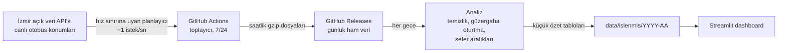

# İzmir Otobüs Düzenliliği

[English](README.md) · **Türkçe**

**İzmir'de otobüsler gerçekte ne kadar düzenli geliyor?** Bu proje, İzmir Büyükşehir Belediyesi'nin açık veri API'sinden ESHOT otobüslerinin canlı konumlarını günün her saati topluyor. Yolcuların her durakta gerçekte ne kadar beklediğini, otobüslerin ne sıklıkla üst üste geldiğini ve hangi hat, durak ve saatlerin en az güvenilir olduğunu ölçüyor.

**Canlı dashboard:** https://eshot-dashboard-vl3mbvk4e7zbeq8dyqga2c.streamlit.app

- **ESHOT'un 446 hattının tamamı:** çalışan her hat yaklaşık 5 dakikada bir, 7/24 sorgulanıyor
- **Tamamen otomatik ve ücretsiz:** veri toplama, depolama, gecelik analiz ve dashboard GitHub Actions ile Streamlit Community Cloud üzerinde çalışıyor
- **Aylık sonuçlar** ve "ayın öne çıkanları": en dakik hat, en çok bekleten hat ve otobüslerin en çok üst üste geldiği hat

## Nasıl çalışıyor?



1. **Toplama.** `collector.py`, her hattaki otobüslerin konumlarını API'den çekiyor. Yolda otobüsü olan hatlar 5 dakikada bir, boş hatlar 30 dakikada bir sorgulanıyor.
2. **Depolama.** Ham veri git geçmişine değil, her gün için açılan bir GitHub Release'e saatlik dosyalar halinde yükleniyor. Böylece depo küçük kalıyor.
3. **Temizlik.** Hayalet kayıtlar ayıklanıyor (aşağıda).
4. **Güzergaha oturtma.** Her konum, hattın resmi güzergahı üzerine izdüşürülüp "güzergah başından kaç metre" bilgisine çevriliyor.
5. **Durak geçişleri.** Otobüsün bir durağın önünden geçtiği an, ardışık iki konum arasında oranlanarak bulunuyor.
6. **Bekleme süreleri.** Aynı durağa art arda gelen iki sefer arasındaki süre, bir yolcunun en kötü durumda bekleyeceği süredir.
7. **Özet.** Her takvim ayı; hat, yön, durak ve saat bazında dashboard'un okuduğu küçük CSV dosyalarına özetleniyor.

## Veride neler buldum ve nasıl çözdüm?

**API kayıtlarının yaklaşık yarısı "hayalet".** API her otobüs için canlı konumun yanında hiç değişmeyen eski konumlar da döndürüyor. İlk hipotezim, yani "ilk kayıt canlı konumdur", yanlış çıktı: sıralama rastgele. Veriyle test ettiğimde **(otobüs, an) gruplarının %96'sında tam olarak bir hareketli kayıt** olduğunu gördüm; geri kalanlar donmuş. Temizlik kuralı bu yüzden hareket eden kaydı tutuyor ve çok sayıda sorguda birebir tekrar eden koordinatları atıyor. Hayalet kayıtların toplandığı yerlere harita üzerinde baktığımızda bunların otobüs garajları, bir aktarma merkezi ve bir benzinlik olduğu ortaya çıktı: Otobüsün seferden çıkmadan önce son durduğu yerler.

**API dakikada yaklaşık 60 istek kabul ediyor.** Tüm hatlar için yazdığım ilk toplayıcı 446 isteği aynı anda gönderiyordu ve bunların yaklaşık %85'i `API rate limit exceeded` hatası alıyordu. Toplayıcı artık uyarlanabilir bir planlayıcı kullanıyor: sınıra takıldığında %15 yavaşlıyor, istekler başarılı oldukça yavaşça hızlanıyor. Böylece sınırın hemen altında kalıyor; isteklerin yalnızca yaklaşık %1,5'i reddediliyor ve bunlar otomatik olarak yeniden deneniyor. Ayrıca o an otobüsü olan hatlara öncelik veriyor.

**5 dakikalık örnekleme yeterince doğru.** 5 hat için dakikalık veri toplayıp bunu 5 dakikada bir örneğe seyrelttim ve analizi tekrar çalıştırdım. 10 hat-yönün 9'unda tipik bekleme 1 dakikadan az, uzun bekleme oranı ise yalnızca birkaç puan değişti.

**Tarife gün içinde değişiyor.** Otobüsler akşam ve gece daha seyrek planlanıyor. Her beklemeyi hattın tüm günkü tipik beklemesiyle karşılaştırmak, akşamın planlı aralıklarını "uzun bekleme" gibi gösteriyordu. Artık her bekleme, aynı hattın **aynı saat dilimindeki** tipik beklemesiyle karşılaştırılıyor. Dilimler: gece, sabah zirvesi, gün içi, akşam zirvesi ve akşam. Hastane hatlarından birinde bu düzeltme uzun bekleme oranını %29'dan %20'ye indirdi.

**Tek otobüslü hatlar da ölçülmeli.** Bekleme süresini başta "ardışık iki farklı otobüs" arasında ölçüyordum. Bu, tek otobüsle çalışan hatları hiç ölçmüyordu; daha önemlisi, bir otobüs seferden çekildiğinde oluşan uzun beklemeleri de görmüyordu. Kural "ardışık iki farklı sefer" olarak değiştirilince ölçülen hat sayısı 291'den 384'e çıktı ve bazı az otobüslü hatların gizli kalan uzun beklemeleri ortaya çıktı.

**Hat uçları güvenilir değil.** Otobüsler son durakta bekleyip geri döndüğü için oradaki geçişler sık sık kaçırılıyor ve sahte uzun aralıklar oluşuyor. Güzergahın geri kalanına göre belirgin şekilde az geçiş tespit edilen duraklar otomatik olarak hesap dışı bırakılıyor.

## Ölçüler

| Ölçü | Tanım |
| --- | --- |
| Tipik bekleme | Bir durağa art arda gelen iki sefer arasındaki sürenin medyanı |
| Uzun bekleme | Aynı saat dilimindeki tipik beklemenin 1,5 katından uzun aralıkların payı |
| Yığılma | Aynı saat dilimindeki tipik beklemenin yarısından kısa aralıkların payı (iki otobüs neredeyse birlikte geliyor) |

Sıralamalar ve öne çıkanlar yalnızca en az 200 ölçümü olan ve tipik beklemesi en az 3 dakika olan hat-yönleri içeriyor.

## Depo

| Dosya | Görevi |
| --- | --- |
| `collector.py` | Hız sınırına uyan planlayıcıyla canlı konum toplayıcı |
| `temizlik.py` | Hayalet kayıt temizliği |
| `analiz.py` | Güzergaha oturtma, durak geçişleri, bekleme süreleri ve aylık özetler |
| `app.py` | Streamlit dashboard |
| `referans_indir.py` | Durakları, hatları ve güzergahları açık veri portalından indirir |
| `.github/workflows/` | Toplama (sürekli), analiz (her gece), referans veri (ayda bir) |
| `data/ref/` | Referans veri (duraklar, hatlar, güzergahlar) |
| `data/islenmis/` | Dashboard'un okuduğu aylık özet tabloları |

Ham konum verisi deponun [Releases](../../releases) bölümünde (her gün için bir release).

## Kendi bilgisayarında çalıştırmak

```bash
pip install -r requirements.txt
python referans_indir.py                     # duraklar, hatlar, güzergahlar
python collector.py --tek-sefer              # 5 örnek hat için tek bir deneme sorgusu
python analiz.py --hepsi                     # verisi olan tüm ayları analiz et
streamlit run app.py
```

## Sınırlar

- Planlanan tarifeler açık veride bulunmadığı için düzenlilik tarifeye göre değil, her hattın kendi tipik beklemesine göre ölçülüyor.
- Hafta içi ve hafta sonu tarifeleri henüz ayrılmıyor.
- Dakikada yaklaşık 60 istekle, en yoğun saatlerde 5 dakikada bir sorgulanabilecekten daha fazla aktif hat olabiliyor. Bu durumda bazı hatlar 6-8 dakikada bir sorgulanıyor; analiz bunu tolere ediyor.
- Günde yalnızca birkaç seferi olan ilçe ve köy hatları çoğunlukla ölçülemiyor.

## Veri ve lisans

Veri: [İzmir Büyükşehir Belediyesi Açık Veri Portalı](https://acikveri.bizizmir.com), İzmir Büyükşehir Belediyesi Açık Veri Lisansı.

## Geliştiren

**Batuhan Semih Orhan** · Bilgisayar Bilimleri, Dokuz Eylül Üniversitesi · [LinkedIn](https://linkedin.com/in/batuhan-semih-orhan-b54359253)
